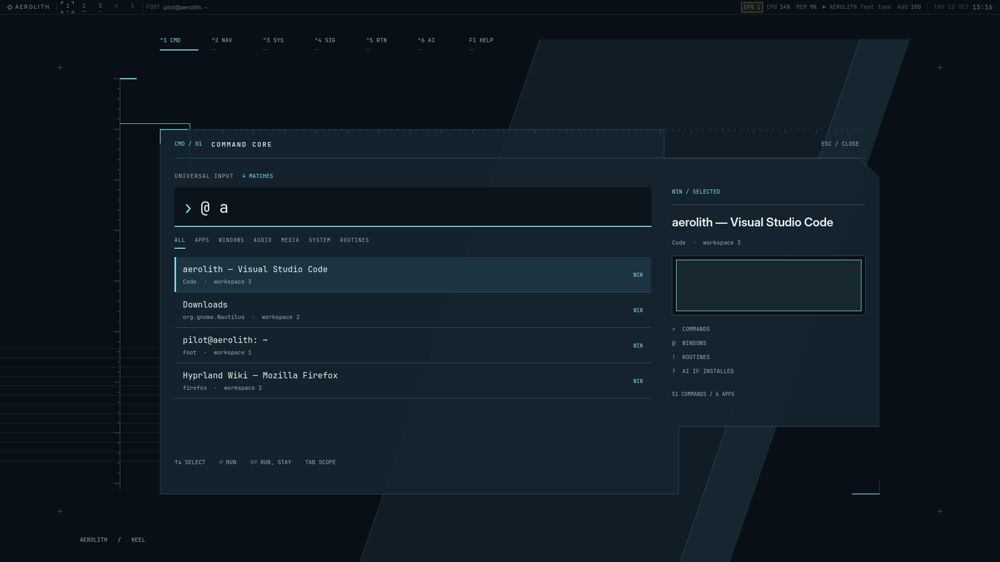
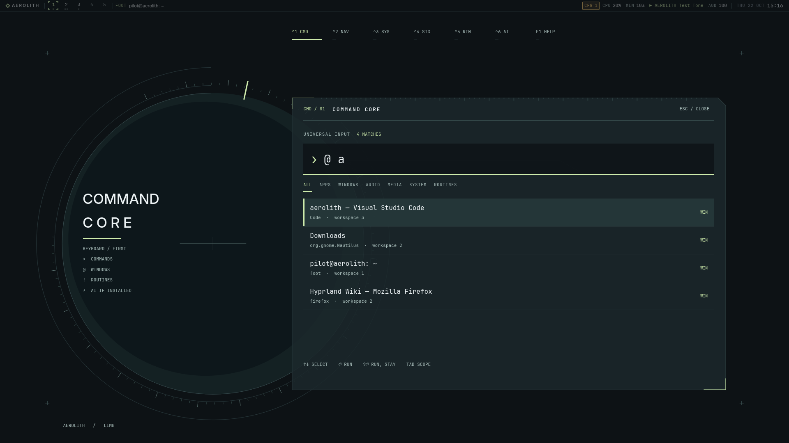
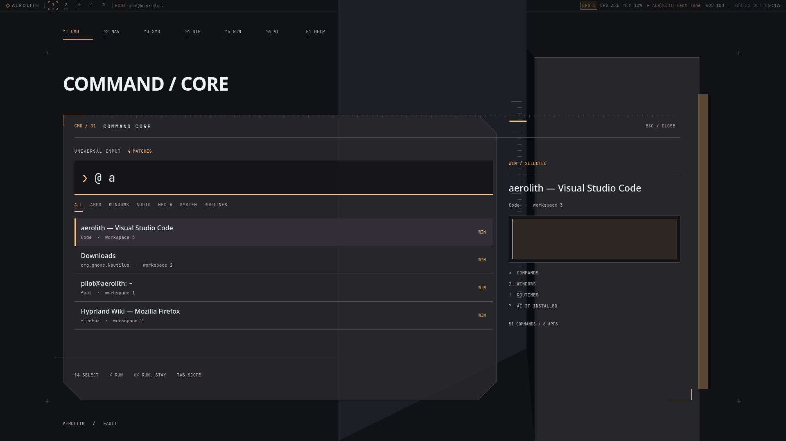

# AEROLITH · Round 2 · UI-002

Three directions grown from the original dark Flight Strip, registration brackets,
tapes and traces. No direction is selected. Start with the three Command Core
screenshots below, then compare the idle grounds, navigators and opening sequences.

## Keel

The desktop is a flight instrument built around a fixed vertical datum. A command
surface extends sideways from it; its stepped outline separates input, results
and the selected object's inspection plane. The three-column workspace field
keeps the original sector navigation while the sloping ground gives the whole
instrument a direction.

- **Colour:** blue-black `#090f16`, smoked blue planes, ice `#87dfed` for selection.
- **Typography:** JetBrains Mono for input, results and instrument labels; a compact, heavier sans face for the selected object.
- **Depth and translucency:** 91% tinted faces over oblique structural planes; fine registration lines remain visible through them. Opaque in low-effects mode.
- **Motion:** a 160 ms extension from the datum, with immediate keyboard focus; reduced motion fades without travel, off snaps.
- **Unmistakable feature:** the fixed measuring spine and the asymmetric, stepped command assembly.

[Show first: Command Core](keel/02-command.png) · [Opening playback](keel/motion.webp)

## Limb

A circular collimator becomes the desktop's organizing field. The Command Core
sits on its right-hand chord, leaving the instrument's centre exposed; the
navigator spreads five workspaces across a shallow arc. The radial marker follows
the active workspace, while every application title and action stays on a readable
horizontal baseline.

- **Colour:** deep petroleum `#0d1215`, grey-green instrument planes, pale phosphor `#ceebac` used sparingly.
- **Typography:** medium Inter Display identification, monospaced commands and measurements; sans window titles in the navigator.
- **Depth and translucency:** concentric, offset dark planes beneath an 86% tinted chord; arcs show through the face without blur. Opaque in low-effects mode.
- **Motion:** a 160 ms expansion from the chord's left origin, with the radial marker settling into registration; reduced motion fades, off snaps.
- **Unmistakable feature:** the exposed circular field intersected by a straight, functional command surface.

[Show first: Command Core](limb/02-command.png) · [Opening playback](limb/motion.webp)

## Fault

The instrument becomes an architectural section: two tall ground planes split
by a narrow recess, a cut command plate to the left, and object information
registered directly against the right structure. Workspace columns step across
the section. The composition gets its tension from offset edges and value changes,
with a single warm selection line tying the parts together.

- **Colour:** carbon `#111215`, graphite and mineral-grey planes, alloy amber `#ffc080` for active information.
- **Typography:** bold Noto Sans identification and result titles, with small monospaced labels and command input.
- **Depth and translucency:** an 86% tinted, chamfered command plate; an exposed inspection plane across the recess; a narrow translucent outer fin. Low-effects mode uses opaque faces and removes the fin.
- **Motion:** the command plate moves up and right while the outer fin closes its gap against the plate, settling in 160 ms; reduced motion fades, off snaps.
- **Unmistakable feature:** the open structural joint between the command plate and the object inspection plane.

[Show first: Command Core](fault/02-command.png) · [Opening playback](fault/motion.webp)

## Captures and runnable files

All retained PNGs are unmodified 1920×1080 software-renderer captures, with the
mock's four window records, real registry search (`@ a`), live system telemetry,
and a notification delivered through the existing notification server.

| State | Keel | Limb | Fault |
|---|---|---|---|
| Idle strip + ground | [PNG](keel/01-idle.png) | [PNG](limb/01-idle.png) | [PNG](fault/01-idle.png) |
| Query in Command Core | [PNG](keel/02-command.png) | [PNG](limb/02-command.png) | [PNG](fault/02-command.png) |
| Workspace navigator | [PNG](keel/03-navigator.png) | [PNG](limb/03-navigator.png) | [PNG](fault/03-navigator.png) |
| Systems bay | [PNG](keel/04-systems.png) | [PNG](limb/04-systems.png) | [PNG](fault/04-systems.png) |
| Notice | [PNG](keel/05-notice.png) | [PNG](limb/05-notice.png) | [PNG](fault/05-notice.png) |
| Opening, six PNGs | [First](keel/06-motion-01.png) | [First](limb/06-motion-01.png) | [First](fault/06-motion-01.png) |
| Opening, settled | [PNG](keel/07-settled.png) | [PNG](limb/07-settled.png) | [PNG](fault/07-settled.png) |

The motion PNGs run from `06-motion-01.png` through `06-motion-06.png` in each
folder. Capture starts are spaced about 35 ms apart; exact times are retained in
`motion-timing.json`. The single-pass WebP previews preserve that sequence.
Software frames sometimes repeat; these captures do not establish GPU smoothness.

Executable roots: `prototypes/r2-keel/`, `prototypes/r2-limb/`,
`prototypes/r2-fault/`. Shared presentation lives in `prototypes/r2-common/`;
services, registry, IPC and core are symlinked to the existing shell. See
[validation and reproduction](VALIDATION.md) for commands, checks and limits.
No production shell files were changed.

## Systems support for the chosen direction

- **Keel:** integrate Claude's background host, retained Deck slots for datum retraction/cross-bay motion, keyed notices and deterministic stacking; suppress duplicate compositor layer animation.
- **Limb:** integrate the same background/Deck/notice hooks, retaining the circular field while chord contents leave or switch; existing workspace signals suffice, with no new sampling or blur dependency.
- **Fault:** integrate the same hooks with separately retained plate and fin transforms, releasing telemetry/audio demand immediately when outgoing; compositor blur remains optional.
