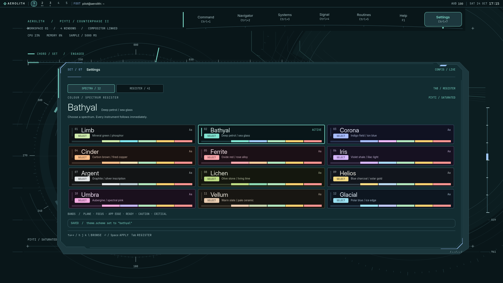

# UI-015 — Spectra

Twelve complete colour environments for AEROLITH. Open **Settings → Spectra**,
click a specimen or browse with arrows / h j k l and press Enter or Space.
The palette saves and applies immediately. Tab opens the existing configuration
register; its Scheme row returns to Spectra. Home/End and Page Up/Down reach
all choices on short displays. Limb preserves the original palette and remains
the default; PIYTI is the base application direction, with THEARS retained.

## Research

The owner's “serpanitum” is confidently identified as
[Serpantinum](https://serpantinum.dev/). Its actual
[ThemeTab QML](https://raw.githubusercontent.com/ilyamiro/serpantinum/master/src/quickshell/guide/theme/ThemeTab.qml)
matches the request: compact three-column tiles show each scheme's own base,
text, name and six colour dots. An outline marks the applied choice; a click
persists and applies it live, including app-template generation. This works
because users compare real surface/accent relationships without leaving the
picker. AEROLITH keeps that immediacy and comparison density, translated into
instrument specimens and ordered bands.

Other primary references, checked 24 October 2026:

- [KDE Colors](https://docs.kde.org/stable_kf6/en/plasma-workspace/kcontrol/colors/index.html): meaningful control previews and distinct selection/focus roles.
- [VS Code themes](https://code.visualstudio.com/docs/configure/themes): quick keyboard navigation and live visual feedback.
- [kitty themes](https://sw.kovidgoyal.net/kitty/kittens/themes/): actual interface preview, search and recent choices.

The design interpretation is our own. With twelve schemes visible together at
1080p, search and categories would add work without improving access.

## The register

Every specimen shows its actual field and text, an inverse SELECT sample,
then six fixed-order bands: **plane, focus, app edge, ready, caution, critical**.
The aligned interaction and status bands expose colour relationships
without asking users to decode arbitrary dots. ACTIVE and the selected rim mark
the applied scheme; white registration corners independently mark keyboard
position. Status names and geometry preserve meaning where Helios gold,
Ferrite rose or Lichen green resemble a status hue.

The grid uses three, two or one columns as width permits. A shallow view reduces
the heading and scrolls, always containing the active specimen after layout.
Existing custom `theme.palette` overrides remain in force; an explicit message
explains why the live shell may differ from the named specimen.

Switching is instantaneous. A colour tween would repeatedly repaint every
instrument Canvas and could temporarily weaken text contrast. Immediate
binding updates preserve readability and make rapid comparison precise.
The Trace Canvas now repaints on palette changes without waiting for a new
telemetry sample. No polling, shader, layer cache or ambient job was added.
The existing single `Theme.ambient` gate, reduced motion, motion off and
lowEffects paths remain in use.

## The twelve spectra and contrast

All are dark mineral environments with distinct field, plane, inscription,
interaction and application-edge relationships. Amber caution, red critical
and green nominal keep their meanings. The named palettes work independently
of Saturated/Insane and PIYTI/THEARS.

The minimum below includes text/status roles on three opaque surfaces,
the 97% panel over a white desktop, 12% caution confirmation tint, navigator
selection tint over its actual dark map, PIYTI edge text and inverse selection.
Every text pair exceeds **4.5:1**; focus/cursor exceed **3:1**. Full values for
all **540 shell pairs** are recorded in [contrast.json](contrast.json) and
executed in Node and Qt V4. Arbitrary user overrides are outside this named
palette guarantee.

| Spectrum | Character | Minimum text/selection | Desktop | Picker |
| --- | --- | ---: | --- | --- |
| Limb | Mineral green / phosphor | 5.381:1 | [View](spectra/limb.png) | [View](picker/limb.png) |
| Bathyal | Deep petrol / sea glass | 5.286:1 | [View](spectra/bathyal.png) | [View](picker/bathyal.png) |
| Corona | Indigo field / ion blue | 5.361:1 | [View](spectra/corona.png) | [View](picker/corona.png) |
| Cinder | Carbon brown / fired copper | 5.240:1 | [View](spectra/cinder.png) | [View](picker/cinder.png) |
| Ferrite | Oxide red / rose alloy | 5.313:1 | [View](spectra/ferrite.png) | [View](picker/ferrite.png) |
| Iris | Violet shale / lilac light | 5.425:1 | [View](spectra/iris.png) | [View](picker/iris.png) |
| Argent | Graphite / silver inscription | 5.170:1 | [View](spectra/argent.png) | [View](picker/argent.png) |
| Lichen | Olive stone / living lime | 4.935:1 | [View](spectra/lichen.png) | [View](picker/lichen.png) |
| Helios | Blue charcoal / solar gold | 4.987:1 | [View](spectra/helios.png) | [View](picker/helios.png) |
| Umbra | Aubergine / spectral pink | 5.367:1 | [View](spectra/umbra.png) | [View](picker/umbra.png) |
| Vellum | Warm slate / pale ceramic | 5.070:1 | [View](spectra/vellum.png) | [View](picker/vellum.png) |
| Glacial | Polar blue / ice edge | 5.129:1 | [View](spectra/glacial.png) | [View](picker/glacial.png) |

The lowest measured shell text pair is Lichen critical over the confirmation
surface: **4.935:1**. The three opaque surfaces alone reach at least **5.353:1**.
[App exports](APP-THEMES.md) check another **780 pairs**, including ANSI colours,
selection ink, all semantic text on pressed/hover fills and Studio selection tints;
minimum **4.527:1**.

## One colour source, application exports

[`shell/lib/schemes.mjs`](../../../shell/lib/schemes.mjs) owns all named colours.
Theme resolves the scheme first, then existing user role overrides. PIYTI's
formerly fixed cyan continuity edge now follows each spectrum's `link` colour;
THEARS uses its interaction colour. The only config addition is `theme.scheme`,
declared with `S.enumOf` and exported by `node tools/gen-schema.mjs`.

[`tools/gen-scheme-themes.mjs`](../../../tools/gen-scheme-themes.mjs) derives
**446 files** from that catalog and the established app shapes: kitty,
Alacritty, foot, btop, GTK 3/4, Qt, Hyprland, Firefox, Discord and Steam,
plus the existing LibreOffice and PhotoCraft adapters. It preserves the
PIYTI/THEARS variants where applicable. `--check` catches stale or unexpected
output. Hover/pressed surfaces are bounded to keep secondary text readable;
decorative rule colours are never substituted for readable control surfaces.

The shell changes live. Selecting/reloading external app files requires
Claude's adapter; all installer, terminal-command and activation requests are
in [SYSTEMS-REQUESTS.md](SYSTEMS-REQUESTS.md). No host app/profile was changed.
[App formats, native-parser results and limits](APP-THEMES.md) are explicit.

## Captures and verification

- [Every scheme across every bay and notices](bays/): 120 actual 1080p captures, PIYTI/Saturated, motion off for consistent inspection; real audio/media fixtures and fake AI provider.
- Four complete 4K sets, each with all twelve grounds and pickers: [PIYTI Saturated](4k/piyti-saturated/), [PIYTI Insane](4k/piyti-insane/), [THEARS Saturated](4k/thears-saturated/), [THEARS Insane](4k/thears-insane/). Physical output is 3840×2160; THEARS/Saturated uses scale 1, the other sets scale 2. Motion is full in all four sets.
- [Picker](picker/): every applied palette, separate cursor/active state, the register, and a live switch with Systems traces already open.
- [Compact](compact/): 1280×720, uiScale 1.25, Noto fallback fonts, Insane, motion off and lowEffects. First and last schemes remain reachable.
- [Live switch MP4](live-switch/switch.mp4) and [sixteen original frames](live-switch/frames/): actual keyboard selection, Limb → Bathyal → Corona in one running Settings bay. This is a sampled 5 fps sequence, with [actual capture timing](live-switch/timing.json); no interpolated transition is implied.
- [Lock](verification/runs/lock-schemes/), [OSD](verification/runs/osd-schemes/) and [session](verification/runs/session-schemes/) preview evidence: disposable visual fixtures, with every scheme and accessibility variants. These prove view styling, not PAM or host lifecycle integration.

[Capture manifest](capture-manifest.json) records unmodified image hashes and
provenance. Reproduction scripts and [QML capture-log audit](verification/capture-log-audit.json)
are in `verification/`. The known headless compositor/UPower/RTKit and unlinked
mpv warnings are distinguished from QML errors. Real Hyprland/GPU/fullscreen
VRAM behaviour and authenticated external apps remain unverified.

Node and Qt V4 each pass 118/118; pytest reports 71 passed and 1 skipped.
Smoke, full, scaled/rotated deck and AI scenarios all pass. PIYTI idle CPU is
0.98% Saturated / 2.36% Insane initially, and 0.93% / 2.47% after use, inside
the approximately 2% / 4% UI-013 budgets. Peak RSS is 207.5 / 203.6 MiB. Exact commands, counts and CPU/RSS evidence are in
[verification/RESULTS.md](verification/RESULTS.md). No production service,
GroundSurface, Deck host or NoticeColumn changed. Git was read-only.

## Biggest weakness, fixed

The initial compact picker could open with the active specimen cut off, hiding
its selection sample and bands. [Before](compact/before-clipped-active.png) /
[after](compact/compact-active-glacial.png). The final implementation contains
the cursor after Qt layout settles, repeats containment on geometry changes,
and reduces heading height on short screens. The independent reviewer accepted
this one revision. [Review findings and corrections](REVIEWS.md) also record
the Trace repaint fix and the completed review of Claude's systems contract.
